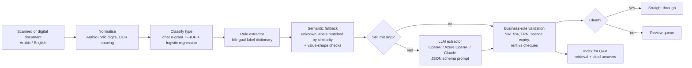

# 📄 UAE Document Intelligence Agent

**An AI agent that reads Arabic and English business documents, extracts the data, checks it against
UAE business rules and answers questions about it.** Built for the paperwork that slows down UAE
finance, KYC, procurement and leasing teams: VAT tax invoices, trade licences and Ejari tenancy contracts.

> Data: 900 synthetic documents in Arabic, English or both, generated in the formats these documents
> really use (5% VAT, 15-digit TRNs, Ejari numbers, Arabic-Indic digits, OCR spacing and character errors,
> issuer-specific labels). No real company or personal data is included.

---

## The business problem

A bank onboarding an SME, a procurement team paying suppliers, or a property manager registering leases
handles thousands of these documents every month. Each one is read and typed in by hand (about 4 minutes
a document), and errors such as a wrong VAT amount, an invalid TRN or an expired licence are often caught late.

## Results (540 unseen documents)

| Metric | Result |
|---|---|
| Document type classification | **100%** |
| Field-level extraction accuracy | **99.2%** |
| Documents with every field correct | 93.5% |
| Accuracy of documents processed without human review | **99.8%** |
| Documents routed to review (gaps or likely OCR misreads) | 6.3% |
| Business-rule checks (wrong VAT, invalid TRN, expired licence, rent split): precision / recall | 98.9% / 99.5% |
| Q&A: correct document retrieved in top 3 / exact answer | 94% / 94% |
| Processing time | ~2 ms per document (offline engine) |

**What that means:** about 94% of documents can go straight through with near-perfect accuracy; the rest are
flagged for a person instead of being silently wrong. At 4 minutes each, every 1,000 documents is about
**67 hours of manual keying saved**.

Results are measured on synthetic documents, whose layouts are cleaner than real scans; on real documents
the share routed to the LLM or to review would be higher. The design (rules first, semantic fallback, LLM
for the rest, review for anything uncertain) is what carries over.

---

## How it works



| Component | Where |
|---|---|
| Synthetic bilingual documents with ground truth and injected errors | `src/docagent/generate.py` |
| Normalisation, classifier, rule extractor, semantic fallback | `src/docagent/extract.py` |
| UAE business-rule validation | `src/docagent/validate.py` |
| LLM providers (OpenAI, Azure OpenAI, Anthropic) via plain HTTPS, no SDK lock-in | `src/docagent/llm.py` |
| Agent: process, route to review, retrieval-augmented Q&A | `src/docagent/agent.py` |
| Evaluation and report | `src/docagent/pipeline.py` |
| Review app (Streamlit) and REST API (FastAPI) | `app.py`, `api.py` |

## Quick start

```bash
git clone https://github.com/vineethasusan/uae-document-intelligence-agent.git
cd uae-document-intelligence-agent
python -m venv .venv && source .venv/bin/activate
make install
make evaluate     # -> outputs/report.md and outputs/metrics.json
make app          # http://localhost:8501
make api          # http://localhost:8000/docs
```

Runs fully offline by default. To add the LLM layer for unseen layouts and generated answers:

```bash
export DOCAGENT_LLM=openai      OPENAI_API_KEY=...          # or
export DOCAGENT_LLM=azure       AZURE_OPENAI_ENDPOINT=... AZURE_OPENAI_KEY=... AZURE_OPENAI_DEPLOYMENT=...   # or
export DOCAGENT_LLM=anthropic   ANTHROPIC_API_KEY=...
```

Sample documents are in `data/samples/`.

## Design decisions

- **Rules first, LLM last.** Deterministic extraction is free, instant and auditable; the LLM is only called for
  fields the cheaper engines could not fill, which keeps cost and latency low and every value traceable.
- **Never silently wrong.** A document with a missing field or a value that looks like an OCR misread (a letter
  inside a number) goes to review instead of straight through. That is why straight-through accuracy is 99.8%.
- **Arabic as a first-class language.** Arabic-Indic digits are normalised, Arabic labels are matched directly,
  and character n-grams are used for classification and retrieval so no Arabic tokeniser is needed.
- **Checks the business actually cares about.** VAT must be 5% of the subtotal, TRNs have 15 digits, licences must
  be valid on the day, and annual rent must split evenly across the cheques.
- **Provider-agnostic.** The same prompts work with OpenAI, Azure OpenAI (for data residency) or Claude.

## Roadmap

- OCR stage for scanned PDFs and photos (Tesseract with Arabic, or Azure Document Intelligence)
- Emirates ID and passport extraction for KYC, with masking of personal data
- Multi-step agent that reconciles invoices against purchase orders and flags discrepancies
- Arabic embeddings for semantic search across contracts

## Author

**Vineetha Susan Alexander** · Senior Data Scientist & AI Consultant, Dubai
[LinkedIn](https://www.linkedin.com/in/vineetha-susan-alexander-465997135) · [GitHub](https://github.com/vineethasusan)

MIT License.
